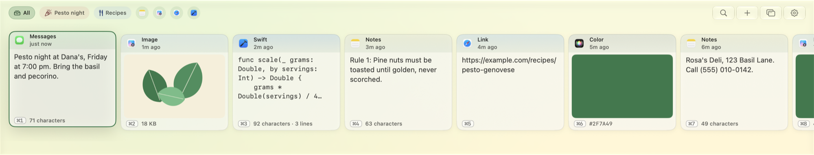
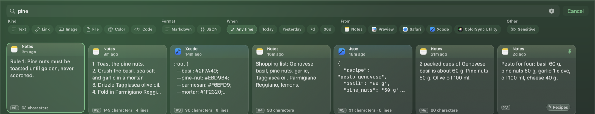
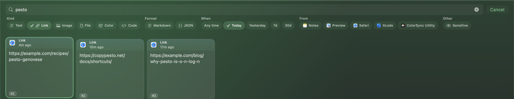
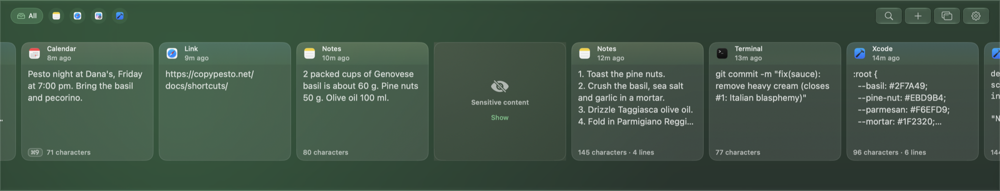
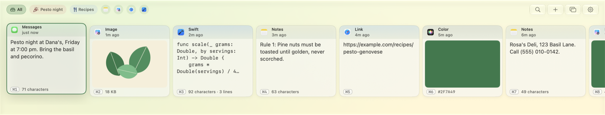
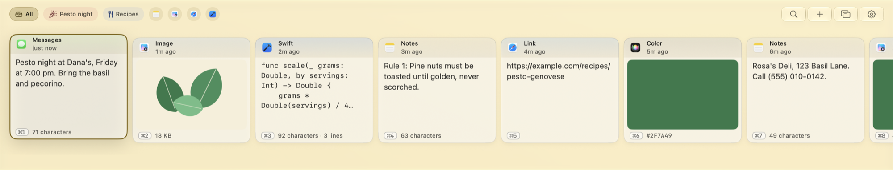
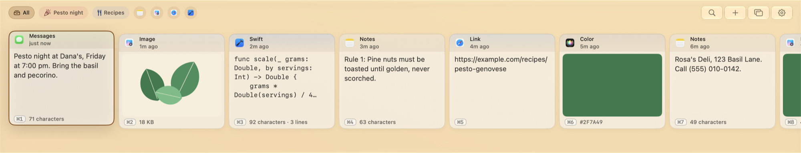
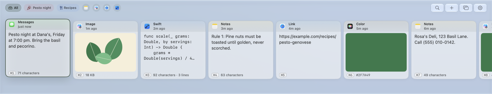

<h1 align="center">Pesto</h1>

<p align="center"><b>Everything you copy. Readable only by you.</b></p>

<p align="center">
Pesto is a native clipboard manager for the Mac. It remembers the text, code, links, pictures, files and colors you copy, and brings them back with one shortcut. Free and open source under the MIT license, for macOS 15 and later. The history is encrypted on disk and in backups; a program running as you can still ask for it, which [Privacy and security](docs/guide/privacy-and-security.md) spells out.
</p>

<p align="center">
  
  
  
</p>

<p align="center">
  <picture>
    <source media="(prefers-color-scheme: dark)" srcset="docs/images/shelf-dark.png">
    
  </picture>
</p>

> **Status:** Pesto is available from the [Releases page](https://github.com/MichaelRo/copypesto/releases) and
> from [copypesto.net/download](https://copypesto.net/download), with its SHA-256. Requires **macOS 15 or later**. Some
> features use Apple Intelligence and say so where they do. Signed with an Apple Developer ID and notarized by Apple.

> **Official downloads:** Pesto is published only at [copypesto.net](https://copypesto.net). Any other site that
> offers Pesto is not ours.

## Why Pesto

I used Paste and had paid for it. Then it required a recurring subscription, and what I had bought no longer covered it.
I did not want to rent access to my own clipboard history, so I built the one I wanted: native to the Mac, free for
everyone, open source, and private by design.

## What it does

Press **⌘⇧V** and your history slides up as a shelf of clips. Arrow to a clip and press Return, or press **⌘1** to
**⌘9**. It lands in the app you were using, a fraction of a second later; a copy is on the shelf before you reach for it.

- **Paste All** (**⌘P**) joins the selected text clips with a blank line and pastes them at once.
- **Paste One by One** (**⇧⌘P**) pastes the first clip, then the next on each plain ⌘V.
- **Undo** (**⌘Z**) takes back a delete or an edit, and **⇧⌘Z** does it again.
- **Secrets** such as card numbers and keys are masked on the shelf until you choose Show.

## Type to find it

Search matches words, meaning (in English) and the text inside pictures, all on your Mac. Filter by type, date or app. Or ask: type
“links from today”, press **Ask**, and Pesto turns your words into filters. It uses Apple Intelligence when your Mac
has it, and simple rules when it does not.

<p align="center"></p>

<p align="center"></p>

More in [Using Pesto](docs/guide/using-pesto.md).

## A clipboard that remembers, and tells no one

- Your history is **encrypted on your Mac** with AES-256-GCM, under a key kept in your login Keychain. No account, no
  analytics, and no server that receives your clips. Backup is off until you turn it on, and it is one encrypted file
  only you can open, even in iCloud Drive.
- **Secrets** (card numbers, keys, tokens, passwords) are masked on the shelf and never indexed. Copies that an app
  marks as concealed, such as those from password managers, are ignored.
- **No clip is sent to an AI service.** On-device AI runs with Apple Intelligence on your Mac, and only there.
- Pesto makes only a few requests: update checks (switchable in Settings) and link previews (off until you turn them on) and links you open.
- Optional Touch ID lock, and **Clear Everything** in Settings, under Data.

The full list of what is stored and sent, including what encryption does *not* protect, is in
[Privacy and security](docs/guide/privacy-and-security.md).

## Clips that know what they are, and more

- **Smart clips.** A date offers *Add to Calendar*, a parcel number offers *Track*, an address opens in Maps, a phone
  number calls.
- **GIFs move.** A GIF copied from Safari, Finder or a chat plays on its card; one copied from Chrome, Arc or Edge plays too,
  because Pesto fetches the GIF the browser pointed to (with Link Previews on; the browser only hands over the first frame).
- **Files stay together.** Copy five files in Finder and you get one clip that pastes all five back, with icons,
  names and a warning if one has moved.
- **Sensitive content, your way.** Blur or hide links to adult sites, and pictures your Mac's on-device model flags
  (macOS 27, best effort, so it can miss things). Mark any clip as sensitive, and find them all again with one filter.
  Return and a double click paste a hidden clip without showing it; showing it is always your choice.
- **Only this Mac, unless you say otherwise.** Copies from your iPhone or another Mac reach Pesto through Universal
  Clipboard. They are ignored by default; turn them on in Privacy and find them with the Other Devices filter.
- **On-device AI** (needs Apple Intelligence on macOS 26 or later; Describe Image needs macOS 27): summarize,
  translate (into English, or English into Spanish), extract, describe a picture. Grayed out with the reason when your Mac cannot.
- **Encrypted backup.** One encrypted file for this Mac in iCloud Drive or a folder you choose, protected by a
  passphrase or a recovery key you can show again later. Automatic backup is off until you set it up, and per Mac.
  Restoring on another Mac is a manual step. Pesto has no server that receives the file.
- **Collections**, paste as plain text, and drag a clip into any app or onto the Desktop. A click picks a clip and a
  double click pastes it.
- **Undo history.** The last 20 actions are kept in memory, encrypted, and forgotten when you lock, clear or quit.
- **Coming from another clipboard manager?** Import from Paste and ten others: Maccy, Alfred, CleanClip, PasteNow,
  CopyClip, PastePal, Pastebot, Clipy, Flycut and Unclutter. Pesto reads a copy of the library and leaves the original
  alone. Snippets come in from Raycast's JSON export. See [Moving from another app](docs/guide/moving-from.md).
- **Yours to script.** Shortcuts, Spotlight and a Control Center button (macOS 26 and later), a `pesto://` URL scheme,
  AppleScript, a Copy to Pesto item in the Services menu, a Copy Text to Pesto action in Shortcuts, and a command-line tool you can build from source. A Hide Clip Contents action (menu bar, Shortcuts or a
  Focus) blurs your clips for a screen share.
- **Made for the Mac.** Liquid Glass on macOS 26 and later, light and dark, four themes (Basil, Parmesan,
  Pine nut, Mortar), an accent color and an app icon of your choice (the theme's own by default), Reduce Motion respected, keyboard
  first.

<p align="center"></p>

The shelf in each theme: Basil, Parmesan, Pine nut and Mortar.

<p align="center">
  <picture>
    <source media="(prefers-color-scheme: dark)" srcset="docs/images/theme-basil-dark.png">
    
  </picture>
  <picture>
    <source media="(prefers-color-scheme: dark)" srcset="docs/images/theme-parmesan-dark.png">
    
  </picture>
  <picture>
    <source media="(prefers-color-scheme: dark)" srcset="docs/images/theme-pine-nut-dark.png">
    
  </picture>
  <picture>
    <source media="(prefers-color-scheme: dark)" srcset="docs/images/theme-mortar-dark.png">
    
  </picture>
</p>


## Install

- **Homebrew (optional).** Run `brew install michaelro/copypesto/pesto` to install the notarized disk image from the
  Releases page. Homebrew checks its SHA-256 and can be a version behind. Pesto updates itself, so `brew upgrade` leaves
  it alone unless you add `--greedy`. Remove it with `brew uninstall --cask pesto`.
- **Download.** Get Pesto from the [Releases page](https://github.com/MichaelRo/copypesto/releases) or from
  [copypesto.net/download](https://copypesto.net/download), check the SHA-256 shown there, open the disk image and drag
  Pesto to Applications.
- **Source.** Build it yourself; see For developers below. The `pesto` command-line tool is in the source tree and is
  not part of the download yet (`make build-cli`).

Then press **⌘⇧V**. Pesto asks for **Accessibility** access once, so it can paste into other apps for you and notice a
double ⌘C (the optional append shortcut). Everything else works without it.

[Getting started](docs/guide/getting-started.md) walks through it.

## Read more

| | |
|---|---|
| [Using Pesto](docs/guide/using-pesto.md) | The shelf, search, collections, pasting, shortcuts |
| [Settings](docs/guide/settings.md) | Every setting, pane by pane |
| [Privacy and security](docs/guide/privacy-and-security.md) | What is stored, what is encrypted, what is never captured |
| [Automation](docs/guide/automation.md) | URL scheme, AppleScript, command line, Shortcuts |
| [Every feature, in detail](docs/feature-reference.md) | The full reference list |
| [Troubleshooting](docs/guide/troubleshooting.md) and [FAQ](docs/guide/faq.md) | When something does not work |

## For developers

Pesto is written in Swift 6 with SwiftUI and AppKit. It needs macOS 15 or later. Xcode 27 builds everything; Xcode 26 builds it without Describe Image and picture screening.

```bash
git clone https://github.com/MichaelRo/copypesto.git && cd copypesto
export PATH="$(scripts/install-tools.sh):$PATH"   # the pinned xcodegen, swiftformat and swiftlint (scripts/tool-versions.env)
git config core.hooksPath .githooks
make setup-signing   # once: a local signing certificate, so macOS keeps Pesto's permissions between builds
make run             # build and open Pesto.app
make test-core       # the fast tests, no Xcode project needed
```

Architecture, how to build and test it, the security invariants and the project's working agreements are in
[docs/development.md](docs/development.md) and [CONTRIBUTING.md](CONTRIBUTING.md). Every important decision has an
[ADR](decisions/). Planned directions live in [ROADMAP.md](ROADMAP.md). Security reports: [SECURITY.md](SECURITY.md). Help: [SUPPORT.md](SUPPORT.md).

Pesto is written with AI coding tools (Claude and Gemini) under human design, architecture records ([decisions/](decisions/)) and a verification suite that checks the security and privacy rules on every change.

## Support

Pesto is free, and every feature is free on every install. If you want to support its development, there is a
[GitHub Sponsors](https://github.com/sponsors/MichaelRo) button on this repository. Donations unlock nothing in the app
([ADR 0001](decisions/0001-free-and-open-source-no-feature-gating.md)).

The early history was condensed before the repository went public; `CHANGELOG.md` lists what each release changed.

## License and name

The code is [MIT](LICENSE). Third-party notices: [THIRD-PARTY-NOTICES.md](THIRD-PARTY-NOTICES.md). The MIT license
covers the code; it does not cover the Pesto name, the logo and app icon (the P mark and the jar) or the artwork. You are
welcome to use them to say that you use, review or write about Pesto; see [TRADEMARKS.md](TRADEMARKS.md) if you plan to fork.
