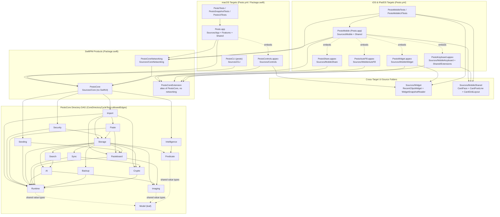
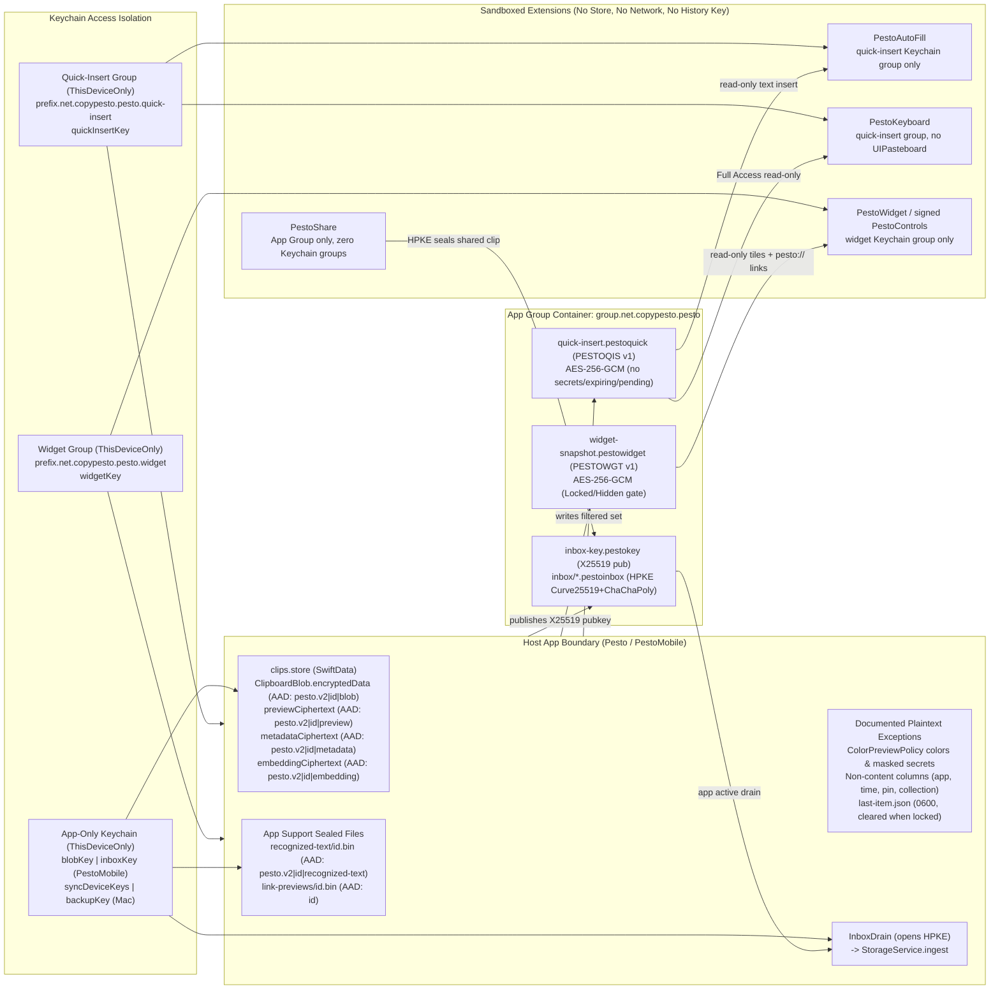
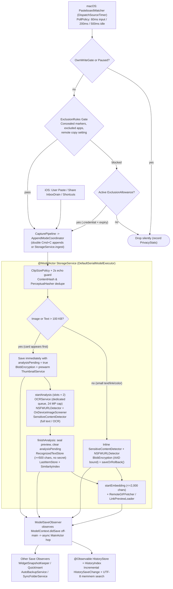
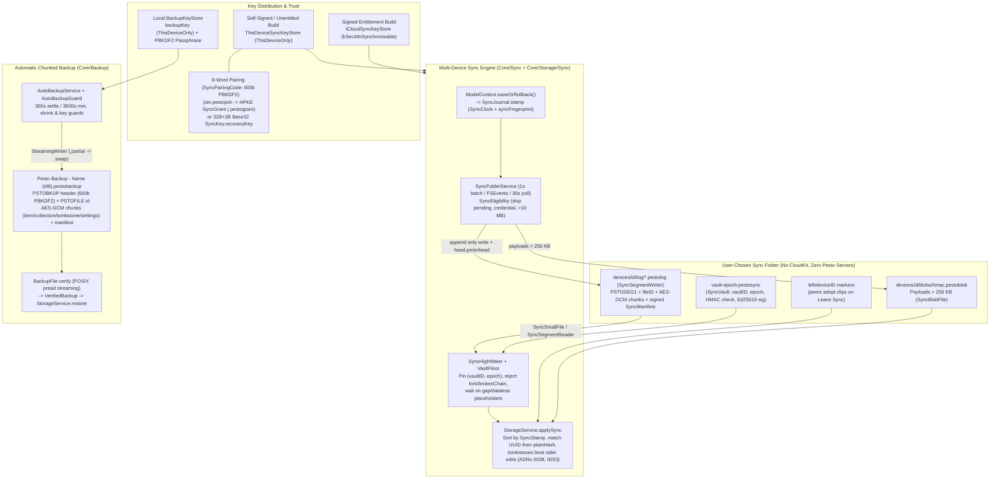

# Pesto Architecture

This document maps Pesto's module structure, trust and encryption boundaries, capture/ingest pipeline, and multi-device sync and backup protocols. For contributor setup and commands, see [development.md](development.md); for invariants and rules enforced by tests, see [AGENTS.md](../AGENTS.md); for individual design decisions, see [decisions/README.md](../decisions/README.md).

---

## 1. Target & Module Dependency Graph

Pesto is organized around one cross-platform SwiftPM package (`Package.swift`) consumed by an `xcodegen`-generated Xcode project (`Pesto.yml`) for macOS 15+ and iOS/iPadOS 26+.

- **`PestoCore` (`Sources/Core`)** holds the UI-free engine (models, CryptoKit encryption, pasteboard watching, SwiftData storage, search, sync, backup, and runtime seams). It never imports `SwiftUI` (`ModuleBoundaryTests`) and builds for both macOS and iOS (`PlatformFenceTests`).
- **`PestoCoreExtension`** is a SwiftPM library product backed by `PestoCore` with zero networking symbols. Every app extension (`PestoControls`, `PestoShare`, `PestoAutoFill`, `PestoKeyboard`, `PestoWidget`) links `PestoCoreExtension` and never `PestoCoreNetworking` (`ExtensionBinaryNetworkTests`).
- **`PestoCoreNetworking` (`Sources/CoreNetworking`)** isolates `LPMetadataProvider`, `URLMetadataFetcher`, `BoundedDownload`, `LinkPreviewLoader`, and `RemoteGIFFetcher` so only the host apps (`Pesto` and `PestoMobile`) and test targets link network code (ADR 0005).
- **Host apps, shared UI, and extensions**: `Pesto` (`Sources/App`, `Sources/Features`, `Sources/Shared`) embeds `PestoControls`; `PestoMobile` (`Sources/Mobile`, `Sources/MobileShared`, `Sources/Shared`) embeds `PestoShare`, `PestoAutoFill`, `PestoKeyboard`, and `PestoWidget`. `Sources/MobileShared` provides iOS card and grid layout views compiled into `PestoMobile`, `PestoKeyboard`, and `PestoMobileTests`. `Sources/Widget` provides `RecentClipsWidget` views, timeline provider, and `WidgetSnapshotReader`, compiled into `PestoWidget`, `PestoControls`, and `PestoMobileTests`.
- **Internal `PestoCore` DAG**: `CoreDirectoryCycleTests` enforces `allowedEdges` so directories under `Sources/Core/` form a strict directed acyclic graph with `Model` as a dependency-free leaf.

---

## 2. Encryption, Keychain & Extension Trust Boundaries

Pesto separates its per-device history encryption key from extension and sync keys so no extension can open `clips.store` or read the history key (ADRs 0002, 0047, 0051, 0052, 0059, 0061).

- **History key (`BlobEncryption`)**: Generated once per install (`AppIdentity.blobKeyAccount`, `kSecAttrAccessibleWhenUnlockedThisDeviceOnly`, never synchronized, not Secure Enclave wrapped) and cached in process via `Mutex<KeyState>`. Every sealed field binds its row UUID and field name as AES-256-GCM associated data (`pesto.v2|<itemID>|<field>` for `blob`, `preview`, `metadata`, `embedding`; `pesto.v2|<id>|recognized-text` in `RecognizedTextStore`; `<id>` in `LinkPreviewImageStore`; `pesto.sealed-file:<filename>` in `SealedFile`).
- **Plaintext exceptions**: Validated color literals (`ColorPreviewPolicy`), masked secret previews (`sensitivityMaskedPreview`), structural metadata (app name, timestamps, byte size, kind, pin/collection flags), and `last-item.json` (`LastItemStore`, owner-only `0600`, cleared by History Lock) for `PestoCLI` and AppleScript.
- **Sealed memory Undo**: `UndoHistory` keeps at most 20 actions / 16 MB of sealed snapshots in memory only (never credentials, expiring clips, or >4 MB clips), cleared on lock, wipe, or quit (ADR 0008).
- **App-group & Keychain isolation**:
  - `PestoShare` holds only the App Group entitlement (`group.net.copypesto.pesto`) and zero Keychain groups. It seals shared clips using the app's published X25519 public key (`inbox-key.pestokey`) via HPKE (`Curve25519_SHA256_ChachaPoly`) into `inbox/*.pestoinbox` (`InboxEnvelope`). Only `PestoMobile` holds `inboxKey` (`AppIdentity.inboxKeyAccount`) and drains them via `InboxDrain` into `StorageService.ingest`.
  - `PestoAutoFill` and `PestoKeyboard` share only the `quick-insert` Keychain access group (`$(AppIdentifierPrefix)net.copypesto.pesto.quick-insert`) and read `quick-insert.pestoquick` (`SealedFileFormat.quickInsert`, max 256 KB set / 2 MB file, AES-256-GCM with `header + purpose` AAD). Secrets, credentials, pending, flagged, and expiring clips are excluded; `PestoKeyboard` reads it only with Full Access and never reads `UIPasteboard` (ADRs 0061–0063).
  - `PestoWidget` (iOS) and signed `PestoControls` (macOS with `SYNC_PROFILE` + `WIDGET_PROFILE`, ADR 0059) share only the `widget` Keychain group (`net.copypesto.pesto.widget`) and read `widget-snapshot.pestowidget` (`SealedFileFormat.widgetSnapshot`, max 1.5 MB, AES-256-GCM). Locked/hidden states replace clips with placeholder snapshots (`WidgetSnapshotGate`).

---

## 3. Capture, Ingest, OCR & Storage Pipeline

On macOS, capture is driven by an input-adaptive timer (`PasteboardWatcher`, ADR 0006); on iOS, capture is always an explicit user action (Paste, Share Extension `InboxDrain`, Shortcuts, or Quick Add, ADR 0046). Both converge on `@ModelActor StorageService.ingest`.

1. **Input-driven watch (`PasteboardWatcher`)**: A `DispatchSourceTimer` on a serial queue adjusts via `PollPolicy` (60 ms for 3 s after input, 200 ms active, 500 ms after 30 s idle). `OwnWriteGate` prevents Pesto's own paste writes from re-entering history.
2. **Exclusion & concealed gates (`ExclusionRules`)**: Types and recent/frontmost sources (`SystemFrontmostAppProvider` / `FrontmostHistory`) are read before any `await` and verified against `changeCount`. Remote Universal Clipboard copies (`com.apple.is-remote-clipboard`) are dropped unless `Setting.keepsRemoteCopies` is on. Password managers in `defaultExcludedBundleIDs` and `concealedTypeMarkers` are dropped silently unless covered by an active timed allowance (`ExclusionAllowances`, stored hidden as `.credential` for at most 24 hours).
3. **Ingest & immediate shelf card (`CapturePipeline` → `StorageService.ingest`)**: Checks `ClipSizePolicy`, suppresses 2 s echoes (`lastIngestedHash`), deduplicates by keyed `ContentHash` or `PerceptualHasher` (`pixelDigest` confirmation), applies `ClipboardRules`, and seals via `BlobEncryption`. Small text/links/colors are analyzed inline; images and texts over 100 KB (`IngestAnalysisInput.backgroundTextBytes`) save immediately with `analysisPending = true` so the card appears right away while heavy work runs asynchronously.
4. **Background judgment & enrichment**: `StorageService.startAnalysis` (bounded to `analysisSlots = 2`) runs `OCRService` on a dedicated utility `DispatchQueue` (never Swift's cooperative pool) using 24 MP downsampled images (`ImageDownsampler.boundedImage`), screens images/URLs via `NSFWURLDetector` and `OnDeviceImageScreener`, and runs `SensitiveContentDetector` over large text and full OCR text. `finishAnalysis` seals the preview, saves up to 100 KB of OCR text to `RecognizedTextStore` (when ≥500 chars and no secret), updates `LastItemStore`, and launches `startEmbedding` (`TextEmbedding` ≤2,000 chars) + `SimilarityIndex`. `startGIFUpgrade` (`RemoteGIFFetcher`) upgrades browser-copied still frames carrying a GIF URL, and `LinkPreviewLoader` / `ClipboardCard+Loading` fetches OpenGraph previews (`URLMetadataFetcher`) when enabled and unlocked.
5. **UI observation (`ModelSaveObserver` → `HistoryStore` & `HistoryIndex`)**: `ModelSaveObserver` listens for `ModelContext.didSave` on the posting thread and hops asynchronously to `@MainActor` (preventing main-actor/storage-actor deadlocks). `@Observable HistoryStore` applies incremental `HistorySaveChange` diffs to `[ClipboardItem]` and `HistoryIndex` (`[HistoryRow]` UTF-8 `memmem` haystacks).

---

## 4. Multi-Device E2EE Sync & Backup Protocol

Pesto has **zero server infrastructure** and never starts CloudKit (`cloudKitDatabase: .none`). Both multi-device sync and local backups operate over user-chosen folders (such as iCloud Drive) using independent formats and independent keys (`SyncKey` vs `BackupKey`).

- **Multi-device sync (`Core/Sync` & `Core/Storage/Sync`)**:
  - **Append-only per-device logs**: `ModelContext.saveOrRollback()` invokes `SyncJournal.stamp(in:)` (suppressed when `SyncJournal.isApplyingRemote` is true) to advance `SyncClock` `(wallMillis, counter, deviceID)` and set `syncDirty = true` only when synced fields change (`syncFingerprint`). `SyncFolderService` batches dirty rows into `SyncOutbox`: inline records go into `devices/<id>/log/<first>-<last>.pestolog` (`SyncSegmentWriter`: `"PSTOSEG1"` + random 16-byte `fileID` + `epoch` hint + AES-GCM chunks under HKDF subkey `"pesto.sync.file.v1"` + SHA-256-chained, Ed25519-signed `SyncManifest`); payloads >256 KB go into `devices/<id>/blobs/<hmac>.pestoblob` (`SyncBlobFile`).
  - **Key distribution & trust**: Signed builds with `com.apple.application-identifier` store `SyncKey` in iCloud Keychain via `ICloudSyncKeyStore` (`kSecAttrSynchronizable: true`). Builds without the entitlement (self-signed macOS, simulator) use `ThisDeviceSyncKeyStore` with either a Base32 checksummed recovery key (`SyncKey.recoveryKey`) or 8-word pairing (`SyncPairingCode`: 80-bit SHA-256 + 600,000-iteration PBKDF2 `"pesto-pair-v2"` over `vaultID` and sorted public keys), exchanging `SyncJoinRequest` (`join.pestojoin`, 24 h expiry) and an HPKE-sealed `SyncGrant` (`<id>.pestogrant`).
  - **Epoch floor & conflict resolution**: `SyncVault` (`vault-<epoch>.pestosync`) binds `vaultID`, `epoch`, HMAC check value, and creator Ed25519 signature. `SyncHighWater.VaultFloor` refuses older epochs or foreign groups (ADR 0039); `Reset Sync` bumps `epoch + 1` with a new `SyncKey`, while `Leave Sync` writes `left/<id>` so peers adopt orphaned clips (`adoptClips`) and bumps `Setting.syncDeviceSerial`. `SyncSmallFile` (1 MiB cap) and `DatalessFile` defer un-downloaded provider placeholders. `StorageService.applySync` sorts by `SyncStamp`, resolves clips by UUID first then `plainHash`, and applies tombstones (`DeletedItemTombstone`, carrying `plainHash` for non-secrets or id-only when a twin holds the text / for withdrawn secrets, ADRs 0038, 0053).
- **Chunked backup (`Core/Backup`, ADR 0010)**:
  - `AutoBackupService` (`AutoBackupPolicy`: 300 s settle, 3600 s min interval) streams records through `BackupFile.StreamingWriter` to `Pesto Backup – <Name> (<id8>).pestobackup` via `.partial`, guarded by `AutoBackupGuard` (rejects in-memory stores, unreadable clips, foreign-key backups, and >50% history shrinkage below `lastClipCount`) and retaining `.previous.pestobackup`.
  - Format: `"PSTOBKUP"` v1 header (salt, 600,000-iteration PBKDF2-SHA256 passphrase wrapping `BackupKey`, HMAC key check) + `"PSTOFILE"` 16-byte `fileID` + AES-256-GCM chunks (`item`, `collection`, `tombstone`, `settings`) bound to `SHA256(header | fileID) | index | isManifest` + manifest chunk. `BackupFile.verify` (`VerifiedBackup`) verifies streaming via POSIX `pread` (2–6 MB footprint) before `StorageService.restore`.

