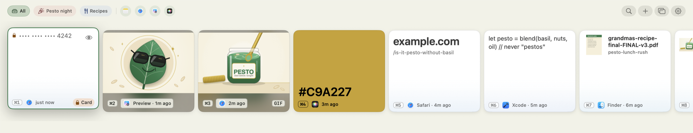

# Pesto user guide

Pesto is a clipboard manager for Mac, iPhone and iPad. It remembers what you copy, keeps it encrypted on your device, and lets you find and paste it again wherever you work.

| Read | When |
|---|---|
| [Getting started](getting-started.md) | Install, first launch, the permission Pesto asks for |
| [Moving from another app](moving-from.md) | Bring in history from Paste and ten other clipboard managers, or snippets |
| [Using Pesto](using-pesto.md) | The shelf, search, collections, pasting, keyboard shortcuts |
| [Pesto on iPhone and iPad](iphone-and-ipad.md) | Library, Share sheet, Shortcuts, AutoFill, keyboard, widgets and sync on iOS |
| [Keyboard shortcuts](shortcuts.md) | Every key and mouse action, on the shelf and everywhere |
| [Privacy and security](privacy-and-security.md) | What is stored, what is encrypted, what is never captured |
| [Settings](settings.md) | Every setting, pane by pane |
| [Automation](automation.md) | `pesto://` links, AppleScript, the `pesto` command, Shortcuts |
| [Troubleshooting](troubleshooting.md) | Paste does nothing, permissions, a locked history |
| [FAQ](faq.md) | Short answers |

Click any picture in the guide to view it full size.

Requires macOS 15 or later on Mac, or iOS 26 / iPadOS 26 or later on iPhone and iPad. On-device AI needs Apple Intelligence on macOS 26 or iOS 26 or later; Describe Image and picture screening need macOS 27 on Mac.
