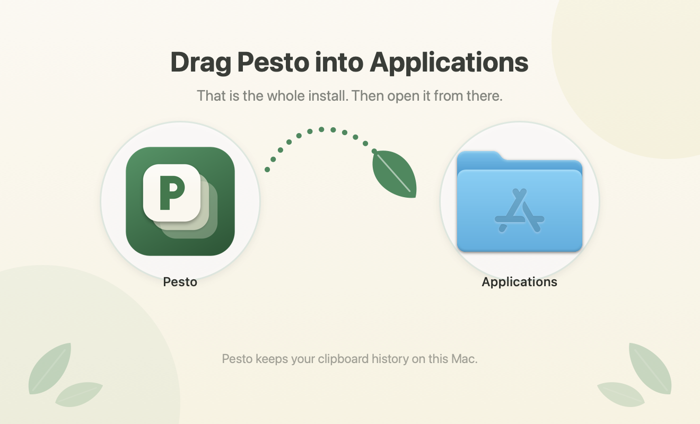
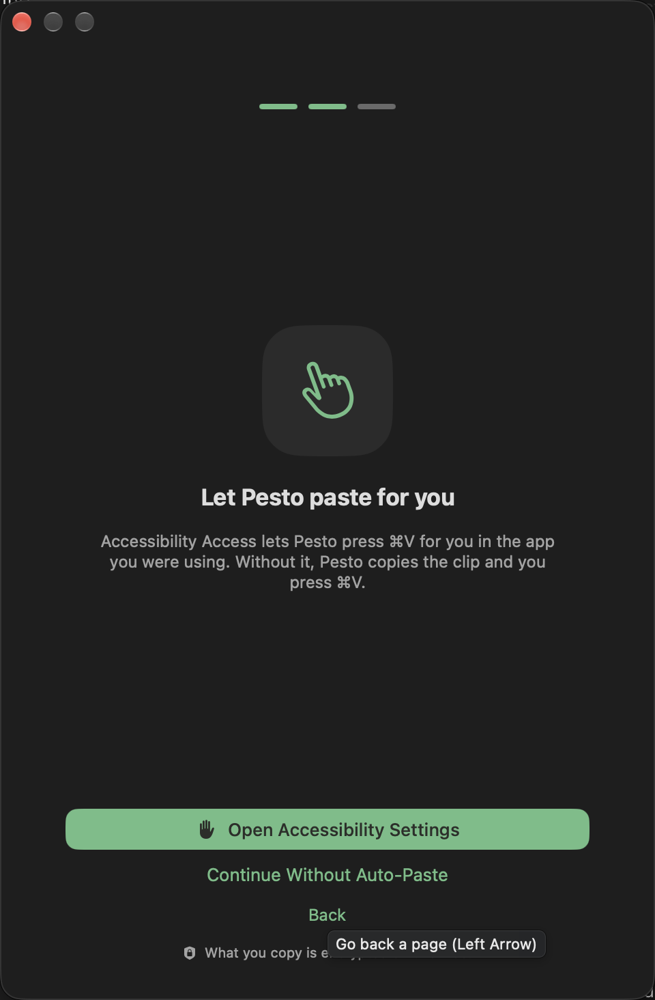
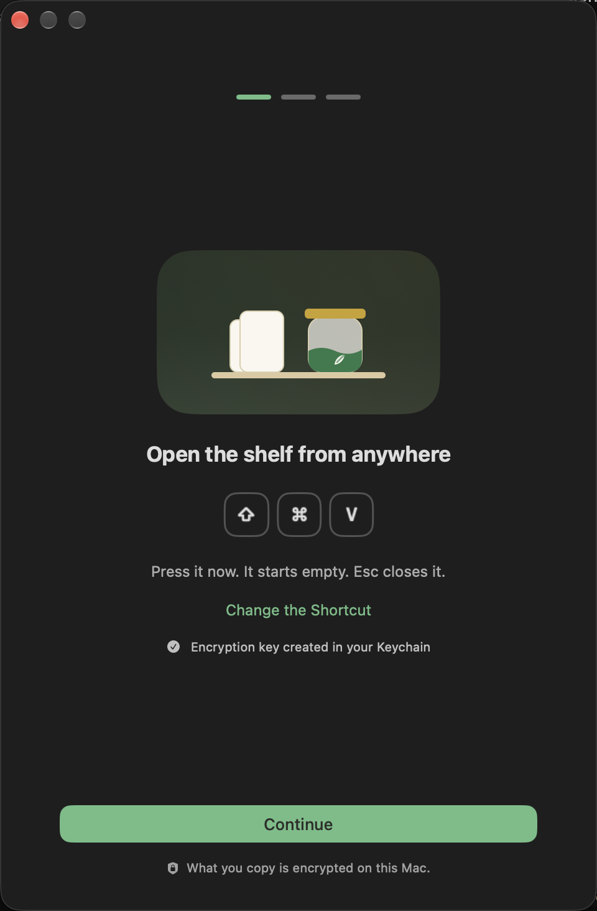
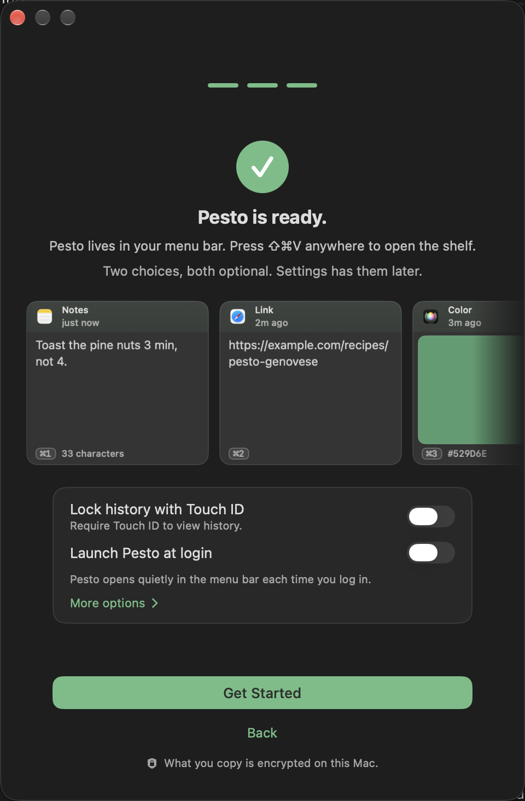

# Getting started

## Install
1. Download Pesto from copypesto.net/download, and open `Pesto-<version>.dmg` from your Downloads folder.
2. The window shows Pesto, a dotted arrow ending in a basil leaf, and your Applications folder. Drag Pesto onto Applications,
   then open it from there.
3. If macOS asks whether to open Pesto, choose Open.

Pesto lives in the menu bar; it shows in the Dock only while Settings, About or the setup window is open.

If you open Pesto straight from the disk image or the Downloads folder instead, it offers to move itself to Applications,
open the copy and eject the disk image. Launch Pesto at login, updates and the paste permission all need that one installed
copy. Choose *Don't ask again* to keep it where it is.

## First launch
A short setup window appears with three steps. It takes about a minute:

1. **Open the shelf.** The window shows your shortcut as keys (⌘⇧V unless you changed it) and invites you to press it
   to see the shelf, which starts empty; *Change the Shortcut* opens Settings. Some apps use ⌘⇧V for "paste without
   formatting", so change it there if that is you. *Continue* also creates the encryption key: a random key stored
   in your login Keychain, with which everything you copy is encrypted before it is written to disk. macOS may ask
   you to allow Keychain access: choose *Always Allow*, which lets Pesto itself, and only Pesto, read the key without asking each time.
2. **Allow pasting.** Pesto asks for the Accessibility permission (if it is already on, the step says so and you continue). It is used to press ⌘V for you in the app you were
   using, and to notice a double ⌘C for the optional append shortcut. Without it Pesto still keeps
   your history, but pasting from the shelf copies the clip
   and shows a small "Press ⌘V to paste" notice, and the double-⌘C setting stays off. Choose *Continue Without Auto-Paste* to skip it; you can grant it later
   in *System Settings → Privacy & Security → Accessibility*.
3. **Make it yours.** Both choices are optional: require Touch ID to view your history (it appears only on a Mac that can
   ask), and *Launch Pesto at login*. Pesto lives in the menu bar, so without it Pesto only remembers what you copy while it is running. *More options* adds the menu bar icon and copies from other devices. Then choose *Get Started*.

Sensitive pictures and links are blurred by default; you can hide or show them instead in *Settings → Privacy*.

## Your first paste
1. Copy something (⌘C) in any app. Do it a few times.
2. Press **⌘⇧V**. The shelf slides up from the bottom of the screen with your recent copies.
3. Use the arrow keys (or the mouse) to pick a clip and press **Return**, or double-click it. Pesto pastes it into the app you were in.

Press **Esc** to close the shelf without pasting.

## The shortcut to remember
| Shortcut | What it does |
|---|---|
| **⌘⇧V** | Open the shelf. Arrow keys move, Return pastes. (*Settings → General* can open a small mouse-only menu at the cursor instead.) |

You can change it in *Settings → Shortcuts*, where you can also record shortcuts for pasting the previous copy and for the floating window. To paste without formatting, choose *Paste As → Plain Text* in a clip's menu.

## Updates
Pesto checks for updates on its own and asks before installing. You can also choose *Check for Updates…* from the menu
bar icon.
