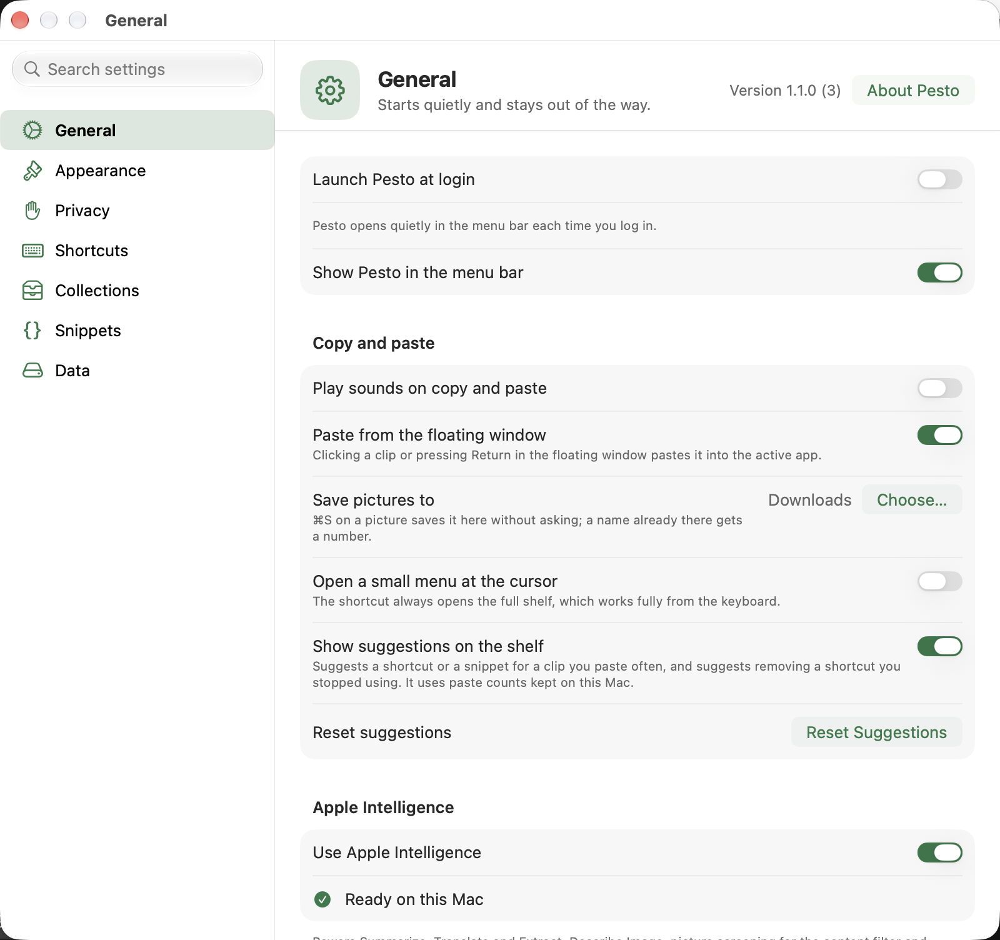
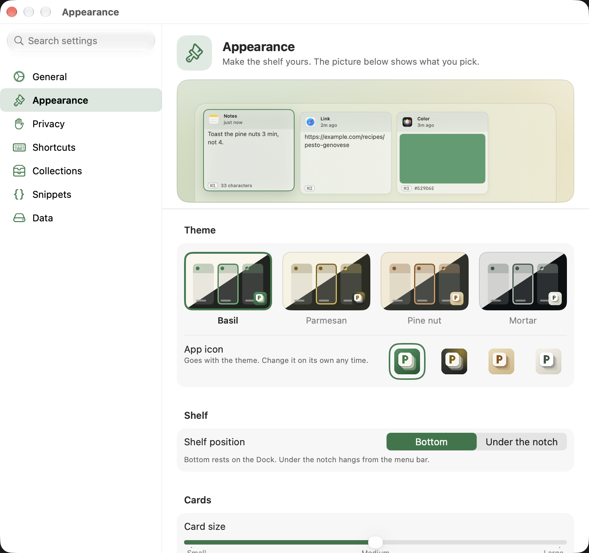
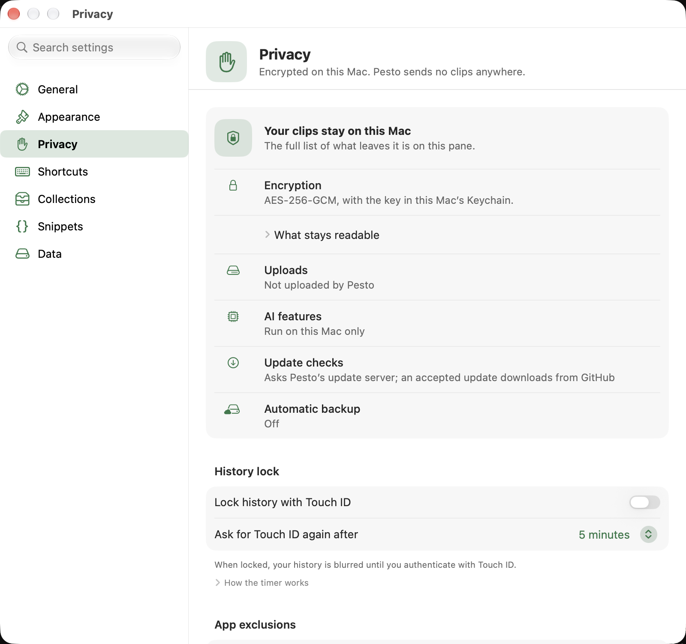
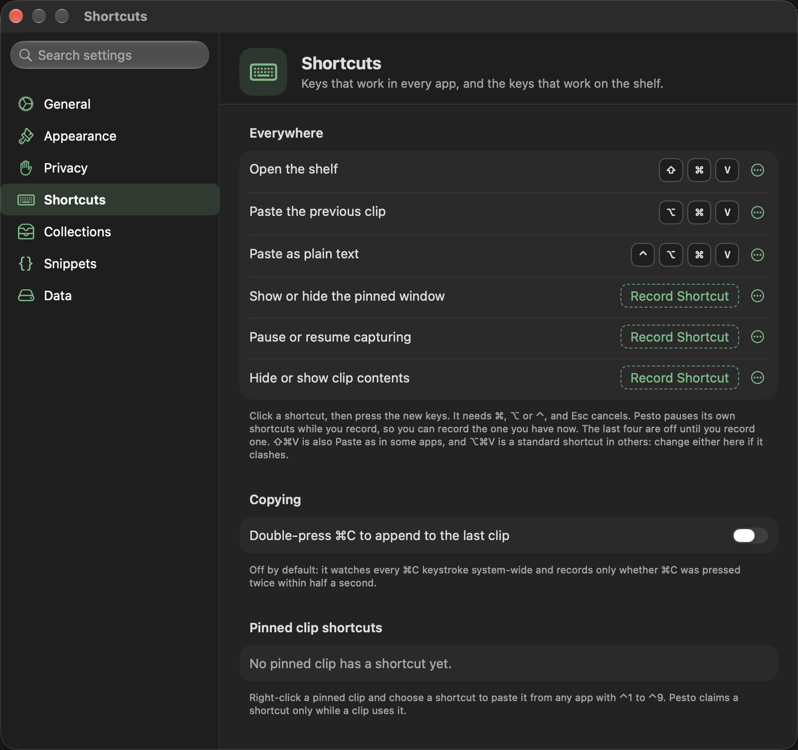
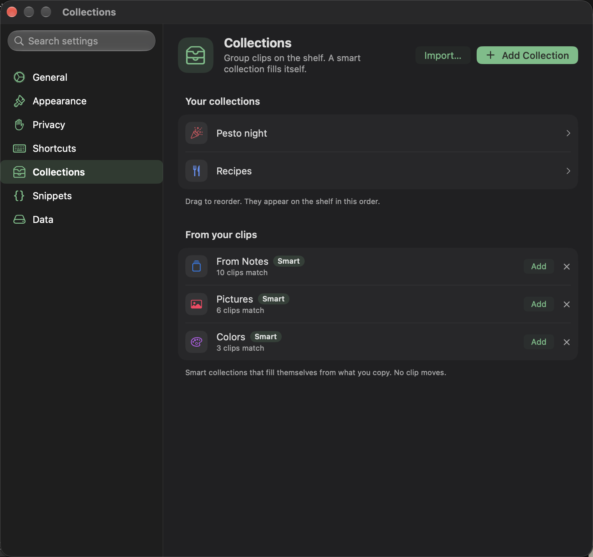
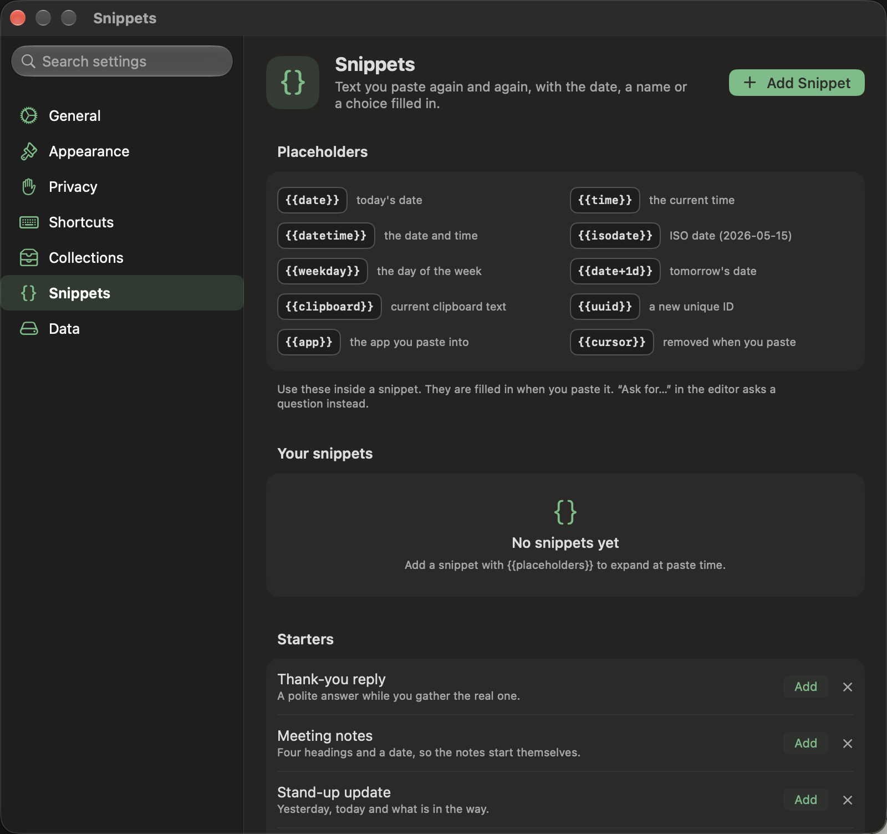
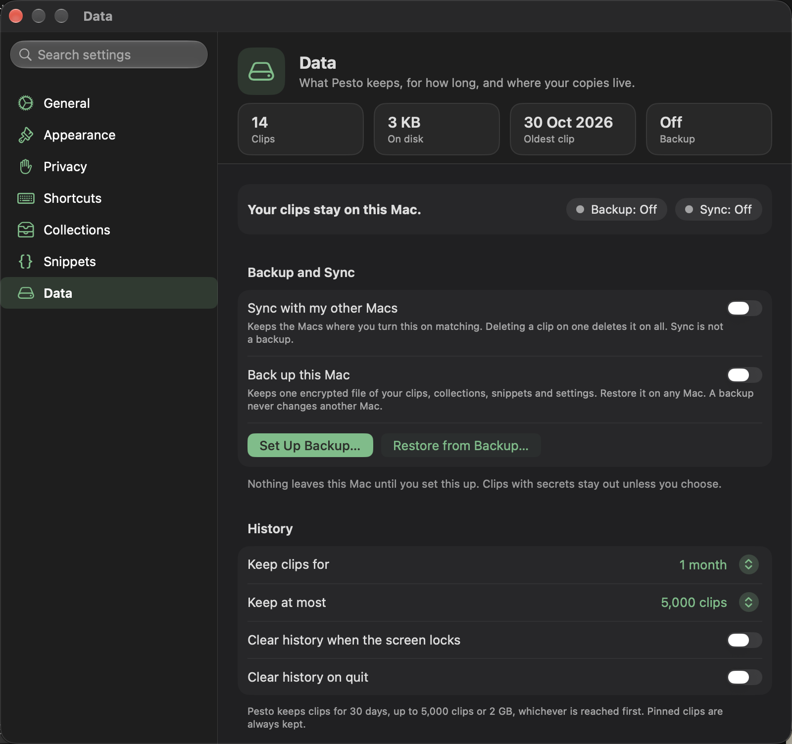
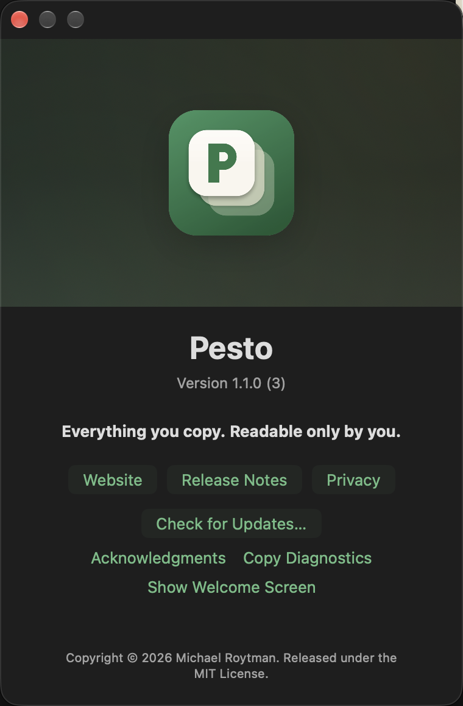

# Pesto settings, pane by pane

Open Settings from the menu bar icon. There are seven panes, each about one topic and each opening with a short header, and
a search field at the top of the sidebar that finds any setting, whichever pane it is in: choosing a result opens the
pane, scrolls to the setting and highlights it for a moment. The defaults suit most people.
The same few rules hold on every pane: a setting shows its state on its own control, information follows settings,
and anything that deletes comes last.

## General

The header shows the version and opens **About Pesto**.

- **Launch Pesto at login**, **show Pesto in the menu bar** and **check for updates automatically** (Pesto asks copypesto.net
  whether a new version exists; the request carries Pesto's version and your IP address, and nothing from your clips). With the menu bar icon hidden, the shelf
  shortcut still opens Pesto, and opening Pesto again from Applications shows Settings. If macOS refuses to register
  Pesto as a login item, the switch says why.
- **Copy and paste:** sounds on copy and paste (off by default), and *Paste from the floating window*: whether a click or Return in
  the floating window pastes the clip or only copies it, and *Open a small menu at the cursor* (off by default): on, in a text
  field the shortcut shows your last five copies by the cursor, for the mouse only (arrow keys and Return go to the app you are typing in); off, it always opens the full shelf, which works
  fully from the keyboard. On the shelf a click only focuses a clip; a double click pastes it.
- **Show suggestions on the shelf** (on by default): Pesto notices clips you paste often and offers a shortcut for a clip you paste on three or more different days, suggests a snippet when clips differ only in a few words, and tidies unused shortcuts. It uses the days a clip was pasted and how alike clips are, kept on this Mac. If you choose No Thanks, Pesto asks again about that clip only after you have used it twice as much and thirty days have passed, and never after a second No Thanks. Reset Suggestions re-arms all suggestions and clears past declines.
- **Apple Intelligence:** one switch, on by default, over every on-device AI feature: Summarize, Translate and Extract;
  Describe Image; picture screening for the content filter; and sentence understanding in Ask. It shows whether this Mac
  is ready. Off, the AI actions are grayed out. There is no account and no key, and nothing you copy leaves your Mac.
- **Permissions:** the status of the permission Pesto needs to paste for you, with buttons that open the right System
  Settings pane.

## Appearance

A picture of the shelf stays at the top of the pane and follows every choice below it.

**Shelf position** is a pair of small pictures, like Light and Dark. It puts the shelf at the *Bottom*, resting on the Dock (the default), or *Top*, hanging from the
menu bar at the top of the screen (below the notch, if your Mac has one). It slides in from that edge, and the hover card opens on the side away from it.

**Theme** sets the look in one choice: Basil (Pesto as it has always looked), Parmesan (warm
cream with a gold accent), Pine nut (sand and toasted amber) or Mortar (cool stone and sage). Each card is drawn half light and half dark, so you see
the theme as it will look either way. A theme sets the accent and the app icon that
goes with it (Parmesan, Pine nut and Mortar also put a light wash over the shelf's glass, and every theme tints the card headers in its color while the app's own color stays on top, lighter), and you can still change the accent or the icon on their own afterwards. The themes are checked so that no
two look alike and every one keeps its text and accent readable in light and dark. **App icon** sits under the themes,
with one icon for each theme, named after it and in the same order: Basil, Parmesan, Pine nut and Mortar. The icon's ground carries the theme and its P is the theme's accent. It shows in the Dock and the app switcher while a Pesto window is open; Finder and
Launchpad keep the default Basil icon, because changing the icon of the installed app would break its code signature.

**Cards:** one slider, with ticks at Small, Medium and Large (160 to 240 points wide; letting go near a tick lands on
it). The text on a card grows and shrinks with it. **Light and dark:** light, dark or follow the system, each shown in the current theme. **Accent color:** the
theme's own (the first swatch, named under the row), Blue, Purple, Pink, Red, Orange, Graphite, or *Other* for any color
(the color panel closes when you choose a preset). **Dark mode:** *Use another theme in dark mode* gives dark its own
theme; the app icon follows the one you picked for light.

## Privacy

- **Your clips stay on this Mac:** the promise, in one card: the encryption (a key in your login Keychain), that your
  clips are not uploaded, that AI runs on this Mac, what the update checks do, and the state of your backup.
- **History lock:** Touch ID or your password, and one setting, *Ask for Touch ID again after* (1, 5, 15 minutes or 1 hour),
  for how long a Touch ID or password stays good: the lock closes again that long after you last unlocked it, and showing a hidden clip,
  and, with the History Lock on, backups and exports ask again after it. Clearing everything and showing the recovery key always ask. Turning the lock
  off asks for Touch ID or your password.
- **App exclusions:** apps Pesto never captures from. Add any app with *Add App…* or from the apps running now, and
  remove it again whenever you like. Password managers are always on the list; *Allow…* on a row (after Touch ID or your
  password, unless you confirmed recently) lets Pesto keep what you copy from that app for 15 minutes, 1 hour, 4 hours or until Pesto quits. What is
  kept is hidden on the shelf as a "Credential" (it may be a username or a password) until you click the eye or choose
  *Show*. It is removed when the allowance ends, and at the latest a day after you copied it; whatever is still kept
  when Pesto starts is removed then. Pin a clip to keep it.
- **Other devices:** whether copies from your iPhone, iPad or another Mac signed in to the same Apple Account (they reach
  your Mac through Universal Clipboard) are kept in your history. Off by default. On, those clips get a phone icon and
  the **Other Devices** chip in the search filter bar shows only them. The chip stays in search while any such clip is in
  your history, even after you turn the setting off. Photos and files copied on another device are not kept: macOS keeps
  them where Pesto may not read them and deletes them as soon as the clipboard changes (⌘V still pastes them, and they
  count under Left out of your history).
- **Left out of your history:** how many copies from excluded apps, concealed sources and other devices were ignored
  (counts only, never what was copied), with a button to reset them.
- **Sensitive content:** how explicit pictures and links appear (Blur, Hide, Show; Blur by default, with a picture of
  each). Pesto asks Apple's on-device model to look at pictures on this Mac; nothing is uploaded.
- **Screen sharing:** *hide contents during screen sharing* (it looks for a mirrored display, a known sharing or
  recording app being open, or the sharing bar of Chrome, Firefox, Edge, Brave or Arc; it cannot see a share of one tab or one
  from Safari; for those, choose *Hide Clip Contents* in
  the menu bar, in Shortcuts or with the shortcut you record in Shortcuts).
- **Outside Pesto:** load link previews (off by default; a preview asks the linked site for its title and picture).

## Shortcuts

Keys that work in every app, and the keys that work on the shelf.

- **Everywhere:** click a shortcut, then press the new keys. It needs ⌘, ⌥ or ⌃; Esc cancels. Pesto pauses its own
  shortcuts while you record, so you can record the combination you have now. It refuses a combination another Pesto
  shortcut or macOS already uses (and says which), and warns on the row when another app holds one. The menu at the end of each row has *Change…*, *Reset to Default* and *Turn Off*. The global shortcuts are *Open the shelf* (⌘⇧V), *Paste as plain text*
  (⌃⌥⌘V); *Paste the previous clip* (it was ⌘⌥V on installs before this changed, and those keep it), *Show or hide the
  floating window*, *Pause or resume capturing* and *Hide or show clip contents* start unset.
- **Copying:** *Double-press ⌘C to append to the last clip* (off by default; it needs Accessibility).
- **Pinned clip shortcuts:** pinned clips can each get ⌃1 to ⌃9. Choose one from a clip's menu (choosing a shortcut pins
  the clip, and unpinning it frees the shortcut); the list shows which clips have one, with a Remove button. Pesto can also offer a shortcut on the shelf for a clip you paste often, and suggest freeing an unused one (Settings → General, Show suggestions on the shelf).
- **On the shelf:** the keys that work while the shelf is open (arrows, Return, Space, ⌘K and the rest). They are fixed.

## Collections

Create, edit, reorder (drag) and delete collections, and build smart collections from rules. Pesto also suggests smart
collections, which fill themselves and never move a clip out of the collection it is in: **From your clips** (Links,
Code, Pictures, Colors and Files when you have enough of them, the apps most of your clips come from, and other
devices), each with how many clips match; **Topics**, groups of clips about the same thing, found on this Mac; and
**Starters** while your history is short. Suggested collections carry a *Smart* label. *Add* creates one and the **x** stops a suggestion from coming back. They appear
when you open the pane, so there is nothing to press. *Add Collection* is in the pane's header.

## Snippets

Text you paste again and again. *Edit* (or a double click) opens the snippet where it sits in the list, and *Add Snippet* opens a new one at the top of the
list, with the same editor: a name, the text, *Insert* chips for the placeholders, and a card that shows what it pastes as.
A snippet holds at least one placeholder, which is filled in or removed when you paste it: `{{date}}`, `{{time}}`, `{{datetime}}`, `{{isodate}}`, `{{weekday}}`, `{{date+3d}}` or `{{date-1d}}` (a day count), `{{clipboard}}` (the text on the clipboard when you paste), `{{uuid}}` and `{{cursor}}`; the editor asks for one before it saves. Esc cancels and ⌘Return saves. After a plain-text paste, the caret lands where `{{cursor}}` was. **Starters** are templates to begin with, and **From your clips** offers text you have
pasted from the shelf more than twice (*Make Snippet*). *Add Snippet* is in the pane's header. The editor's *Ask for…* menu adds a
question that is asked when you paste, and *Suggest Names* renames the fields of a snippet made from similar clips with the on-device model.
All the tokens are in [Using Pesto](using-pesto.md#snippets).
- **Remember fill-in values** (on by default): a fill-in starts with what you typed last time. The values are kept with the snippet, encrypted
  like its text. Turning it off erases them.
- **Suggestion statistics:** how many suggestions the shelf has shown and how you answered them, counted on this Mac from the list it already keeps. *Copy Summary* copies plain numbers you can paste into an issue; nothing is sent anywhere.

## Data

Four tiles at the top: how many clips, how much disk they take, the oldest clip and the state of the backup.

- **History:** how long to keep clips (1 day to forever; default 1 month) and how many (default 5,000); pinned clips are
  never removed. Clear history when the screen locks, or on quit.
- **Clean up copied text:** strip tracking parameters (so a link you paste can differ from the one you copied: the
  `utm_` and ad-click tags are removed), normalize line endings, trim whitespace, collapse duplicate spaces. Each is a
  switch, and they apply as the text is stored.
- **Backup:** a status line says whether backup is on, paused after a clear (with *Resume Backup…*) or off. It is one encrypted file for this Mac, set up once with *Set Up Backup…* and off until then (and per Mac).
  Choose where it goes (iCloud Drive is suggested, or any folder), how it is protected (a passphrase, or a recovery key
  only, which needs no passphrase to remember but must be kept safe) and whether it *keeps itself up to date*: then
  Pesto rewrites the file a few minutes after your history changes, at most once an hour (the pane says when the next
  one is due), and with that off it writes only when you press *Back Up Now*. *Show Recovery Key…* shows the key again
  (after Touch ID or your password) so you can copy it or save it as a file. Clips that hold secrets are left out
  unless you include them at set-up (a copy kept from a password manager under an allowance is never included), and so are clips over 10 MB, such as large pictures. Each backup keeps the file it replaces as a previous copy beside it, so a clip you delete stays in that copy until the next backup. The backup also carries your
  settings (never the history lock, the screen-sharing blur or the excluded apps). *Restore…* (any backup
  file, with the passphrase or the recovery key) shows what the file holds first, adds only what you do not already
  have, never reorders your history, and warns you if the file is older than your last backup. *Restore settings too*
  is on by default; settings that would delete history or keep less of it are not applied until you press *Apply These
  Too* when the restore is done. Other Macs' files are never read or changed. *Remove Backup…* stops it on a Mac you do
  not want backed up, such as a work laptop; the file stays in its folder until you delete it. There is no separate
  settings file: the backup is how your preferences move to another Mac.
- **Found on this Mac** (shown when another clipboard manager is installed): one row per app with its own *Import…*; it reads nothing until you choose that app's file and confirm. The same imports are under *Another app's library* below, for apps Pesto cannot find.
- **Import and export:** your text clips as a JSON file (the first 500 characters of each; unencrypted, secrets masked, no pictures) and back. *Import…*
  under **Another app's library** brings in clips from Paste (see [Moving from another app](moving-from.md#moving-from-paste)), Maccy, Alfred,
  CleanClip, PasteNow, CopyClip, PastePal, Pastebot, Clipy, Flycut or Unclutter, or a CSV, JSON or text file of clips from any other app (**Other File…**: you say which column is the text, when it was copied and what is pinned, or what one clip is in a text file, and the usual preview follows), or snippets from a Raycast export file (TextExpander and Alfred can convert theirs to it): single-brace placeholders such as `{date}` become Pesto's, text
  with no placeholder is pinned as a clip, and anything Pesto cannot fill in (like `{clipboard}`) is left as typed.
- **Maintenance:** rebuild the semantic search index if results feel stale.
- **Activity:** copies per day, what types you copy, your most pasted clips and which apps you copy from, for the last
  7 or 30 days.
- **Start over:** *Clear Everything* removes every clip, pinned ones too, and your collections and snippets, after Touch
  ID or your password. Your settings stay, and the welcome screen does not come back. If a backup is on, you choose
  whether to keep or delete it; backup then waits until you resume it.

## About Pesto

The version and build, the website, the release notes and the privacy page, *Check for Updates…* and *Show Welcome Screen*. Open it from the
menu bar or from the header of the General pane.

Esc closes the Settings window, except while a field, a sheet or the shortcut recorder is using it.
