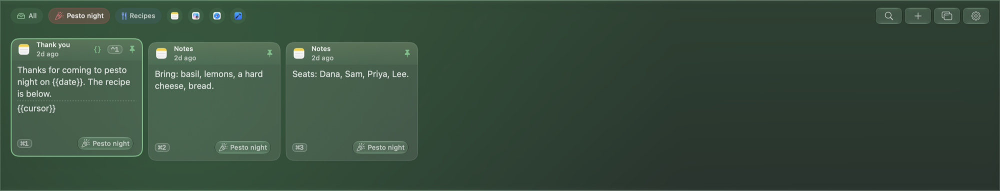
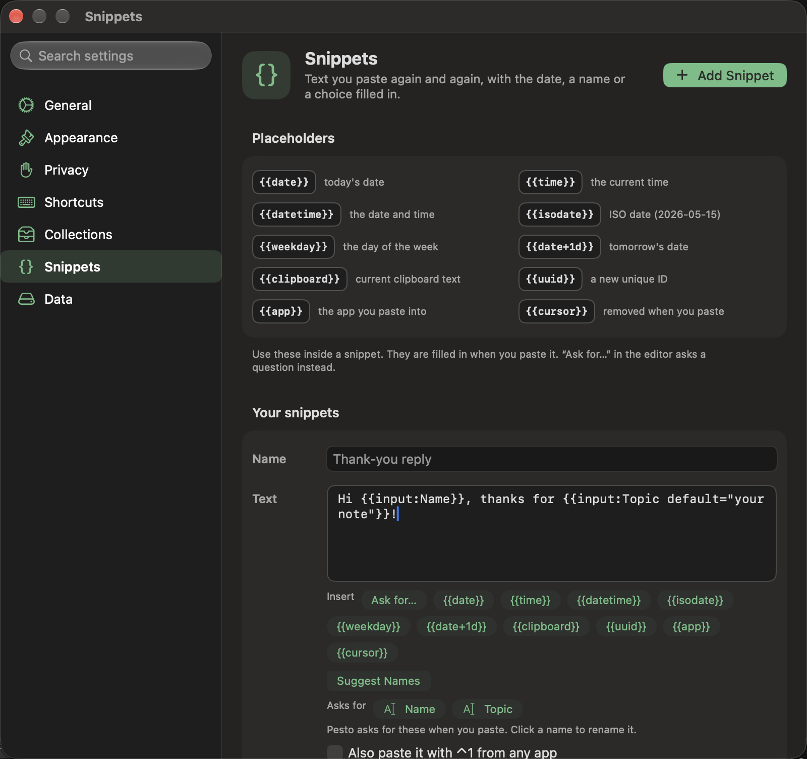
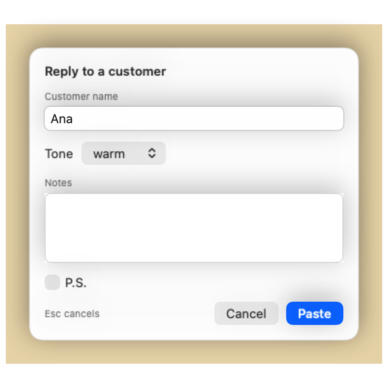

# Using Pesto: the shelf, search and collections

## The shelf

Press **⌘⇧V** to open the shelf. Each card is one clip: text, code, a link, a picture, a file, or a color. A card shows
a preview, the app it came from, and when.

A text clip shows its paragraphs, with a slim dotted gap for a blank line. When the whole clip is shown, the footer adds its size, such as "64 characters · 8 lines". A card shows 4, 5 or 6 lines at the Small, Medium and Large sizes.

- **← →** move between clips, **Return** pastes the selected clip, **Esc** closes the shelf.
- **Start typing** to search. Search matches the first 500 characters of each clip, its title, note and tags, and the text inside pictures; search by meaning works in English.
- **Space** selects a clip so you can act on several at once (for example paste them together). **⌘A** selects every clip currently shown, so you can filter first and then delete or paste them all.
- **⌫** deletes the selected clips, or the focused one when none is selected; Return confirms and Esc keeps them.
- **Undo.** After a delete a bar reads *Deleted 3 clips* with an **Undo** button, and **⌘Z** takes back the last delete or change; **⇧⌘Z** does it again. It covers deleting clips and collections, renaming, notes, tags, icons, moving a clip to a collection (also by dragging), pinning, paste shortcuts, the sensitive mark, a dragged card's place, creating, editing, duplicating and reordering collections, adding or editing a snippet, and an import. In *Settings* the Edit menu's *Undo* does the same, and names the action. Pesto remembers the last 20 actions, only until you lock the history, clear it or quit. *Clear History* and *Clear Everything* are final, and so is deleting a clip that expires on its own, a hidden password or a very large clip; the question before a delete says which it is.
- In search, **Return** pastes the focused result (the first one to start with), and **⌘Return** asks Pesto, and the arrow keys **←** **→** **↓** **↑** move through the
  results.
- A clip the sensitive-content filter blurs pastes like any other: **Return**, **⌘1** to **⌘9** and a double click paste
  it without showing it, so you can paste a link without seeing the picture that comes with it. Showing it is always
  your choice: the **Show** button on the card, **Show** in its menu (**⌘K** opens it from the keyboard), or the *Show*
  action for VoiceOver.
- Hover a clip for a moment, or move to it with the arrow keys, to see a larger preview with the whole text, a link's title, a picture's text or a file's path, and one line of facts. It closes when you move away, or on Esc; a long clip scrolls inside it when you move the pointer into it, and Quick Look shows it whole. A click focuses a card; a double click pastes it, and ⌘-click or ⇧-click selects it.
- Animated GIFs play in the shelf when your Mac allows it (System Settings → Accessibility → Display → Auto-Play Animated Images, and Reduce Motion off); otherwise they show their first frame and play while you hover or focus them.
- Right-click a clip for its menu: copy, pin, tag, add to a collection, expire it after a while, Quick Look, and any
  actions that apply to it.
- Drag a clip straight into another app, or onto the Desktop or a Finder window, where text and pictures arrive as files.
- **Save Image** (also ⌘S on the focused clip) writes a picture to your Downloads folder, or the folder you chose in Settings → General → Save pictures to, under its title, or
  "Pesto picture" and the date, and never replaces a file already there. A covered or hidden picture is not saved. A color
  card has **Copy As**: HEX, RGB, HSL, a SwiftUI `Color` or an `NSColor`. Pesto recognizes `#RGB`, `#RGBA`, `#RRGGBB` and `#RRGGBBAA`, and `rgb()` and `hsl()` with commas or spaces, as colors; a four-letter hashtag such as `#cafe` is not one.
- **Open With** appears for text that contains something actionable: a phone number (Call: a North American number, or any number that starts with +), an email (Compose), an address (Open in Maps), a date (**Add to Calendar**, which opens a calendar file so Calendar asks you; Pesto needs no calendar permission), a carrier tracking number (**Track with UPS, USPS, FedEx or DHL**, opened in your browser; most numbers are checked by their check digit, so a typo is usually not offered, and a FedEx, DHL or 20-digit USPS number needs the carrier's name in the text), a place (**Open in Maps** for an address or for coordinates written as `37.7749, -122.4194`, with a semicolon or a space between, or in degrees, minutes and seconds) and web links inside text.

## Search

Type to filter. Longer queries (more than eight characters) also find clips that *mean* something similar, not only
ones that contain the words. This runs on your Mac.

- The **Sensitive** chip in the filter bar shows only sensitive clips: the ones Pesto hid as secrets (cards, keys, passwords) and the ones marked sensitive. Press **⌘A**, then the trash button, to delete them all.
- `@work` filters to clips tagged "work"; `@swift` filters by detected language. The **Format** chips (Markdown, JSON) put `@markdown` or `@json` in the search field for you: text written in Markdown and anything that is one JSON object or array.
- While searching, chips let you narrow by kind, time or the app a clip came from; each group has a caption, and the clear button sits inside the search field. With *Keep copies from other devices* on (Settings →
  Privacy), an **Other Devices** chip shows only what you copied on your iPhone or another Mac.
- Screenshots and photos are searchable by the text inside them.

## Collections

Collections keep related clips together.

- Click **+** in the chip bar to create one without leaving the shelf. Pick a name and an icon; Pesto gives it a color you can change later.
- **⌘[** and **⌘]** switch between collections while the shelf is open.
- **⌘1 to ⌘9** paste the first nine clips, the number shown on each card.
- **⌘K** opens the actions of the clip you have selected with the arrow keys (Copy, Rename, Add Note, Move to Collection and the rest), the menu a right-click shows.
- *Smart collections* fill themselves from rules you set, for example "all links from Safari this week". Build them
  in *Settings → Collections*, which can also suggest collections based on what you copy.
- Right-click a collection chip to edit, duplicate, export or delete it. *Export Collection…* saves its text clips to a file you choose; *Settings → Collections* has the same command and can import a file back. Deleting a collection does not delete its clips.

## Pinning
Pin a clip to keep it forever: pinned clips are never removed by the retention limits or by *Clear History*.
You can also give up to nine pinned clips their own shortcut (**⌃1** to **⌃9**) that pastes them instantly.

## Pasting
- **Return** or a double click on a clip pastes it into the app you were using.
- **⇧Return** pastes the focused clip directly as plain text (available for text, code, links and colors).
- **⌘C** copies the focused clip to the clipboard without pasting or closing the shelf.
- **⌘Y** toggles Quick Look for a larger view of the focused clip (text, picture, PDF, HTML or URL).
- **Paste the previous copy** directly with a shortcut you record in *Settings → Shortcuts* (it was ⌘⌥V before; a Mac that already used Pesto keeps that).
- **⌃⌥⌘V** pastes as plain text (if it does nothing, see *Shortcuts*: another app may own the combination).
- **Paste As…** is in a clip's menu (**⌘K** opens it from the keyboard). It pastes the clip as plain text, or transforms it first: case conversions (lowercase, UPPERCASE, Title Case, Sentence Case, camelCase, PascalCase, Slug-Case), line sorting and deduplication, JSON formatting/minifying, Base64 encode/decode, URL encoding/decoding, tracking parameter removal, cryptographic hashes (MD5, SHA-256) and more: 26 transforms in all.
- The **cursor menu** (off by default; *Settings → General* turns it on): when you press ⌘⇧V while typing in a text field, a compact list of your last five copies opens
  next to the cursor. It is for the mouse only: arrow keys and Return go to the app you are typing in.
- The **floating window** (the window button in the shelf's toolbar, or the menu bar) is a small copy of the shelf that stays on top. It opens on the display of the app you are working in; the shelf does too, and falls back to the display under the pointer when no app window is in front. Click a clip there to paste it (or copy it, if you turned off *Paste from the floating window*).
- **Paste One by One.** Select several clips and press *Paste One by One* in the bar that appears (or **⇧⌘P**): the first pastes when the shelf closes, and each plain ⌘V in any app pastes the next. A small panel at the top right shows where you are, with Stop Pasting One by One (also in the menu bar). Without Accessibility, the shortcut that opens the shelf (⌘⇧V unless you changed it) puts the next one on the clipboard, ready for ⌘V.
- **Paste All.** Select two or more text clips and press *Paste All* (or **⌘P**): they are joined with a blank line and pasted at once. Nothing new is saved.
- **Append.** Optionally, pressing ⌘C twice quickly
  appends the second copy to the first (turn it on in *Settings → Shortcuts*; it needs Accessibility).

## AI actions (optional)
Right-click a text clip (or press **⌘K**) for *Summarize*, *Make Concise*, *Key Points*, *Professional*, *Translate* (into English, or English into Spanish) or *Extract*. They run on your Mac with Apple Intelligence: no
account, no key, nothing sent anywhere. They need macOS 26 or later. On a Mac without Apple Intelligence they are grayed
out and the menu says why; *Settings → General → Apple Intelligence* shows whether this Mac is ready, and turns every AI
feature off with one switch. The model reads as much of a long text as fits its window; when it could not read all of it,
the answer says "Based on the first N of M characters." **Summarize** and **Key Points** on a text longer than that read it a part at a time: the first part comes at once, then the panel asks "Read the next part?" and each click is one more request on your Mac, never made ahead of the click. Each part's answer stays on screen under the characters it covers, *Cancel* ends the request in flight and keeps what was read, a part that fails offers *Try Again*, and after the last one *Combine Into One Summary* makes one more request over the part summaries. Pesto reads at most the first 100,000 characters, and what is left of the text is forgotten when you close the panel. Picture cards offer **Describe Image** on macOS 27 with Apple Intelligence.

## Files
Copy files in Finder and Pesto keeps them as one clip, however many you copied, and pastes them all back. It stores the
file's location, never its contents, so a big file costs nothing and nothing inside it is read. The card shows the file's
icon or a preview of it (a picture or PDF shows what is in it), its name and its folder. If the file has been moved or
deleted, the card says so. Dragging a group of files out of the shelf drags the first one.

A PDF or an SVG copied on its own (for example a selection from Preview, or a shape from a vector app) is kept as a
picture clip and pastes back as the original file type. PDFs and SVGs get a preview.

## Snippets
A snippet is a pinned clip whose text holds a `{{token}}`. Pesto fills the tokens in when you paste it, in any app.
Make one in *Settings → Snippets*, or from a suggestion.

**Fills from the Mac** (no question asked): `{{date}}`, `{{time}}`, `{{datetime}}`, `{{isodate}}`, `{{weekday}}`,
`{{date+3d}}` and `{{date-1d}}`, `{{clipboard}}`, `{{uuid}}`, `{{app}}` (the app you paste into) and `{{cursor}}` (where the
caret lands afterwards).

**Questions asked when you paste.** A small panel opens over the app you are in, with a row for each:

| Token | What it asks |
|---|---|
| `{{input:Customer name}}` | One line of text. |
| `{{input:Notes multiline}}` | A box for several lines. |
| `{{input:Customer name default="Acme"}}` | One line, starting with a value. Put a value in quotes, so it can hold `|` or a single `}`. |
| `{{choice:Greeting options="Hi|Hello|Dear"}}` | A pick from the options, the first to start. |
| `{{optional:P.S.}}Thanks again!{{/optional}}` | A switch that keeps or drops the text between the tags (off to start). |

A label used twice asks once. Return pastes, **⌘Return** pastes from a box of several lines, Esc cancels, and Tab moves between rows.
The *Ask for…* menu in the snippet editor writes these tokens for you, the questions show as chips under *Asks for* (click one to rename it), and a new snippet can claim the next free `⌃1`–`⌃9` shortcut with one checkbox. A snippet pasted one by one with a stack asks everything
before the first clip. If a token is misspelled or has no label it pastes as typed.

Pesto starts a field with what you typed last time. That is kept with the snippet, encrypted like its text, and turned off
(and erased) with *Settings → Snippets → Remember fill-in values*. A value that looks like a secret is never kept.

**Snippets from your own clips.** When you have copied three or more clips that differ only in a few words (a name, an
order number) on at least two days, and you paste one from the shelf, Pesto offers *Make Snippet…*: the editor opens
with the shared text and a field where they differ. *Suggest Names* asks Apple's on-device model for better field names
(it needs Apple Intelligence and is greyed out with the reason when it is unavailable).
For text you paste the same way over and over, Pesto offers a shortcut instead.

Snippets come in from Raycast and TextExpander exports: their fill-ins (`{argument}`, `%filltext`, `%fillpopup`, `%fillpart`) become
the tokens above.

## Ask Pesto
Type a sentence in the search field, such as “the invoice link from last week”, and click **Ask**. Pesto turns it into filters (type and date) and keywords, and you can adjust the chips afterwards. With Apple Intelligence on, the on-device model reads the question; without it, Pesto uses simple rules for words like *link*, *picture*, *today* and *last week*. Dates are the same coarse ranges as the filter bar (today, 7 days, 30 days). Nothing leaves your Mac.

## Shortcuts and Spotlight
Pesto’s actions are App Shortcuts, so they show up in the Shortcuts app and in Spotlight (type “Search Pesto” or “Open Pesto”). *Search Pesto* opens the shelf with your query already typed; *Copy from Pesto* and *Copy Text to Pesto* work in your own shortcuts.

## The menu bar
The menu bar icon opens the shelf, the floating window and Settings. It also has *Pause Capturing*, *Hide Clip Contents*
(and *Show Clip Contents* afterwards), *Stop Pasting One by One* while it is running, *Clear History* (the last 5 minutes, the
last hour, today, or everything except pinned clips; each asks you to confirm), *Check for Updates…* and *About Pesto*.
